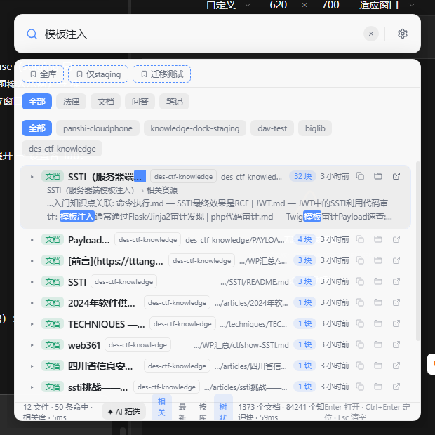
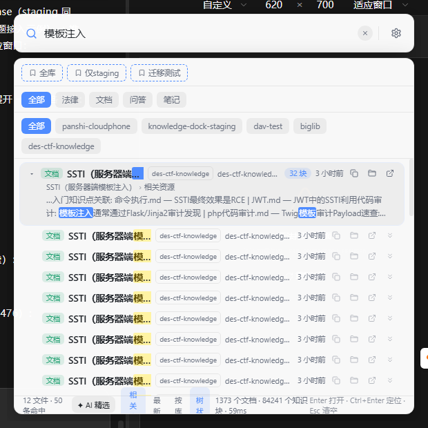
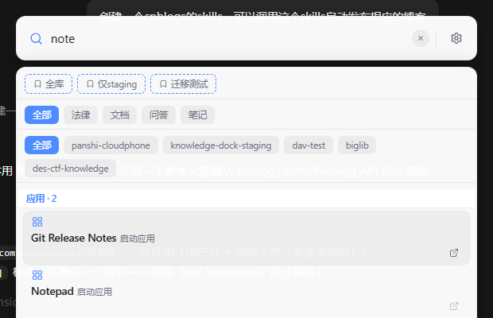
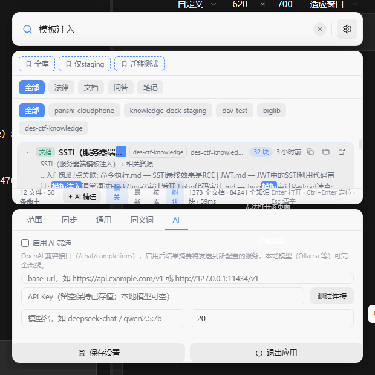
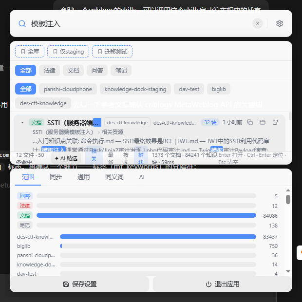

# knowledge-dock 知识悬浮搜索

uTools 风格的本地知识库/应用/工具一体化检索悬浮窗：一条**常驻置顶**的极简搜索框，输入即搜——知识库命中、开始菜单应用、CTF 答题检索，`Enter` 直接打开。支持 Git 仓库 / WebDAV 远程目录接入，可选 AI 精选与 AI 筛选接口，全程本地运行、数据不出本机。




## 特性总览

**搜索与展示**
- Tantivy BM25 + jieba 中文分词 + 同义词改写，标题/面包屑加权；差异化切块（法规条文 / Markdown 标题树 / 问答题对 / 纯文本）
- **树状折叠**：同一文件的多块命中合并为一行（右侧标"N 块"），点击展开子命中，层级清晰不刷屏
- 显示模式：相关度 / 最新 / 按库分组，可叠加 AI 精选、树状折叠独立开关
- 范围限定：类型徽标 chips、知识库 chips、`@前缀` 快捷范围（输入 `@库名 关键词` 只在库内搜），搜索框旁实时显示范围徽章
- 命中高亮（含同义词命中）、上下文就地展开（源文件前 10 行 + 后 20 行）、结果无限滚动（500 条上限保护）
- **应用搜索**：输入关键词第一层优先显示开始菜单应用，`Enter` 直接启动

**数据源**
- 本地目录（多根，每根可独立配置排除/扩展名/大小上限）
- Git 仓库（浅克隆 + 定时拉取，支持分支切换，私有库可配凭据）
- WebDAV 远程目录（坚果云/Alist 等，只读镜像同步，凭据 DPAPI 加密）

**AI 引擎（可选）**
- OpenAI 兼容接口（DeepSeek / GLM / OpenAI / 本地 Ollama 均可），零 Rust 依赖（curl CLI）
- **AI 精选**：模型过滤搜索结果，只留真正相关的条目；UI 与 HTTP API 双入口
- API Key DPAPI 加密落盘；未启用/失败时静默回退 BM25 全量结果，不阻塞、不报错

**系统集成**
- 全局快捷键（默认 `Alt+Space` 唤起/隐藏切换）、失焦自动隐藏、钉住模式、窗口位置/宽度记忆
- 系统托盘：显示/隐藏、钉住切换、重新扫描、**开机自启**、打开配置目录、HTTP 接口状态
- **本地 HTTP 检索接口**（默认 `127.0.0.1:18230`）：供 CTF 答题脚本等外部程序直接调用
- 运行日志按天滚动落盘 + 设置面板一键打开日志目录 + `/api/logs` 远程查看
- 配置健康巡检（重复根/目录不存在/无效规则/源失配）+ 一键修复 + 配置备份轮换 + 导入导出/预设

## 运行截图

| 树状折叠（同文件去重） | 树状展开 | 应用搜索第一层 |
|---|---|---|
|  |  |  |

| 设置 · AI 筛选 | 设置 · 范围与索引统计 |
|---|---|
|  |  |

## 快速开始

1. 从 [Releases](../../releases) 下载 `knowledge-dock-portable.exe`（免安装）或 NSIS 安装包
2. 启动后悬浮搜索框置顶显示，`Alt+Space` 唤起/隐藏
3. 设置 → 范围 → 添加知识库目录（或 Git 仓库 / WebDAV）
4. 输入关键词即搜，`Enter` 打开源文件

系统要求：Windows 10/11（内置 WebView2 运行时，缺失时 NSIS 安装包会自动安装）。

## 使用说明

### 搜索语法

| 输入 | 行为 |
|---|---|
| `关键词` | 全库 BM25 检索，标题/面包屑加权 |
| `@法律 关键词` | 只搜"法律"类型；`@库名` 只搜该库；命中后搜索框旁显示范围徽章 |
| `关键词` + 类型/库 chips | 同上，可视化筛选 |
| `notepad` | 第一层显示匹配的开始菜单应用，`Enter` 启动 |
| `Esc` | 关设置 → 清空 → 隐藏窗口 |
| `↑↓` / `Enter` / `Ctrl+Enter` | 选择 / 打开 / 资源管理器定位 |

### 高级搜索语法

| 语法 | 示例 | 说明 |
|---|---|---|
| `"精确短语"` | `"模板注入"` | 整体短语精确匹配，不分词 |
| `-排除词` | `模板注入 -wp` | 排除含该词的结果（WP 文章等） |
| `+必须词` | `注入 +代码` | 该词必须出现 |
| `title:词` | `title:SSTI` | 仅标题匹配 |
| `path:片段` | `注入 path:techniques` | 路径包含过滤 |
| `type:x` | `注入 type:manual` | 类型限定（manual/law/qa/note） |
| `root:库名` | `模板注入 root:des-ctf-knowledge` | 库限定 |
| `mtime:>Nd` / `mtime:<Nd` | `注入 mtime:>7d` | 最近/早于 N 天修改的文件 |

可自由组合：`"模板注入" root:des-ctf-knowledge type:manual -articles`。HTTP 接口同样支持（`q=` 内含语法）。

### 树状折叠

同一文件的多个命中块自动合并为一行（右侧"N 块"角标），点击行展开该文件的子命中（缩进树状），避免同文件刷屏。底部"树状"按钮可切换折叠/平铺，偏好自动记忆。

### AI 筛选

1. 设置 → AI → 填写 OpenAI 兼容 `base_url` / `API Key` / 模型名 → 测试连接 → 启用
2. 搜索结果面板点 "✦ AI 精选"：模型对命中摘要做相关性过滤，只留真正相关的条目
3. 支持本地模型（Ollama 等）完全离线；任何失败静默回退全量结果

### 知识库接入

- **本地目录**：设置 → 范围 → 选择并添加目录
- **Git 仓库**：设置 → 同步 → 粘贴 URL（私有库可在 URL 内带 token）→ 克隆并添加；分支列可编辑，改动后点"更新"自动重建克隆切换分支
- **WebDAV**：设置 → 同步 → 集合 URL + 账号密码 → 添加并同步（只读镜像）
- **CTF 知识库示例**：可直接接入 [Dest1ny-Sec/Des-CTF-Knowledge](https://github.com/Dest1ny-Sec/Des-CTF-Knowledge)（1100+ 篇 CTF 攻击手册，接入即得 8 万+ 知识块检索）

### 运行日志排查

- 日志文件：`%APPDATA%/com.local.knowledgedock/logs/kd-YYYY-MM-DD.log`（按天滚动）
- 设置 → 通用 → **打开日志目录**；或托盘 → 打开配置目录
- 远程：`curl http://127.0.0.1:18230/api/logs?lines=200`

## HTTP 检索接口（供外部程序调用）

应用启动后自动监听 `127.0.0.1:18230`（默认启用，仅本机可达；端口/token 在 `config.json` 的 `api` 字段，改动需重启）。

| 端点 | 说明 |
|---|---|
| `GET /api/search?q=关键词&limit=20&type=&root=&ai=1&token=` | 检索；`limit` 1-100；`type`/`root` 可选过滤；`ai=1` 走 AI 筛选（未启用自动回退，响应带 `ai_used`） |
| `GET /api/stats` | 索引统计（各库块数 / 类型分布） |
| `GET /api/health` | 存活探针 |
| `GET /api/logs?lines=200` | 运行日志尾部 |

```bash
curl "http://127.0.0.1:18230/api/search?q=SSTI%20%E6%A3%80%E6%B5%8B&limit=5"
```

```json
{
  "ok": true, "total": 5, "query": "SSTI 检测", "duration_ms": 3, "ai_used": false,
  "hits": [
    { "path": "des-ctf-knowledge/SSTI.md", "title": "SSTI（服务器端模板注入）",
      "doc_type": "Manual", "snippet": "…", "root": "des-ctf-knowledge",
      "abs": "C:\\…\\SSTI.md", "mtime": 1795101558000, "score": 12.3, "line": 42 }
  ]
}
```

**CTF 答题脚本接入示例（Python）**：

```python
import requests

def ask(query: str, limit: int = 5) -> list[str]:
    r = requests.get("http://127.0.0.1:18230/api/search",
                     params={"q": query, "limit": limit}, timeout=10)
    r.raise_for_status()
    return [f"{h['title']} ({h['path']})\n{h['snippet']}" for h in r.json()["hits"]]

# 题目关键词直接检索知识库
for item in ask("SSTI 模板注入 检测 payload"):
    print(item)
```

## 配置说明

配置文件：`%APPDATA%/com.local.knowledgedock/config.json`（设置面板可视化修改；保存自动备份轮换最近 5 份）

| 字段 | 默认 | 说明 |
|---|---|---|
| `roots[]` | — | 知识库根：`path` / `label` / `enabled` / `root_exclude_globs`（每库独立排除，如 `*.idx.md`）/ `root_exts` / `root_max_file_kb` |
| `scope` | — | 全局范围：`exclude_globs` / `include_globs`（白名单）/ `include_exts` / `max_file_kb` / `max_age_days` |
| `git_sources[]` | — | Git 源：`name` / `url` / `branch` / `enabled` / `interval_min`（0=仅手动）/ `last_sync` / `last_error` |
| `webdav_sources[]` | — | WebDAV 源（凭据 DPAPI 加密） |
| `presets[]` | — | 范围预设（一键切换知识库组合） |
| `ai` | 关闭 | `{enabled, base_url, api_key(dpapi:密文), model, timeout_ms, top_n}` |
| `api` | 启用 | `{enabled, port(18230), token}`；改动需重启 |
| `shortcut` | Alt+Space | 全局快捷键 |
| `width` / `pin_mode` / `x` / `y` | 600 / false | 窗口形态 |

## 从源码构建

```bash
npm install            # 仅 tauri CLI
npm run tauri build    # 或直接推送到 GitHub，由 Actions 构建并发布
```

- CI（GitHub Actions，windows-latest/MSVC）：push 自动构建 portable + NSIS 安装包并上传 artifact；推送 `v*` tag 自动创建 GitHub Release
- Rust 云端闭环：`.github/workflows/build-loop.yml` 在 staging 推送后构建保留符号的 `dev-release` 产物；驱动脚本为 `.claude/skills/rust-ci-dev-loop/scripts/loop_driver.sh`，依次执行 `precheck`、`watch`、`fetch_run`，历史记录写入 `.agent-loop/history.md`
- 本地开发：rustup stable-gnu + MSYS2 ucrt 工具链（详见 `src-tauri/.cargo/config.toml`），`cargo check` 快速类型检查

## 工程基线与协作

- **[`BASELINE.md`](BASELINE.md)**：权威工程基线——开发环境、迭代闭环（改 → 检查 → 推 staging → CI → 下载产物 → 实机验证）、版本与发布规则、验证标准、已知环境坑
- **[`AGENTS.md`](AGENTS.md)**：agent/协作者必须遵循的最简执行约束
- **[`tools/`](tools/)**：可复现验证脚本——`quiz-test.js`（答题检索回归）、`syntax-test.js`（高级语法回归）、`attach-ctf-source.js`（CTF 知识库接入）
- 当前工作目录：`C:\Users\Admin\Desktop\code\SerachDock`；推送通道：`staging`（CI 触发），`origin` 待主仓凭证恢复后补发

## 项目结构（核心）

```
ui/                     零打包器前端（vanilla JS + 内联 SVG）
src-tauri/src/
  lib.rs                窗口形态/快捷键/托盘/IPC/文件监听/位置记忆
  engine.rs             Tantivy BM25 + jieba + 持久化索引 + 同义词改写
  indexer.rs            差异化切块（法规/手册/问答/笔记 → DocumentChunk）
  matching.rs           范围规则匹配（glob 纯函数）
  gitsync.rs            Git 浅克隆/拉取/分支切换（git CLI）
  webdav.rs             WebDAV 镜像同步 + DPAPI 凭据（curl CLI）
  apps.rs               开始菜单应用枚举与搜索
  ai.rs                 OpenAI 兼容筛选客户端（curl CLI）
  http_api.rs           本地 HTTP 检索接口
  logging.rs            按天滚动文件日志
  config.rs             配置读写/迁移/备份
scripts/gen-icon.mjs    图标生成（纯 Node 绘制 PNG）
.github/workflows/      GitHub Actions 构建与发版
```

## 技术栈

Tauri 2（Rust）· Tantivy 0.25 + jieba-rs · pulldown-cmark · notify（文件监听）· WebView2 + 零打包器前端（vanilla JS）· curl CLI（Git/WebDAV/AI 网络层，零额外 Rust 依赖）· std::net（HTTP 接口/日志）· DPAPI（凭据加密）

## 隐私

- 检索、索引、切块全部本地完成；**默认无任何网络请求**
- 启用 AI 筛选后，命中**摘要**会发送到你配置的模型服务（可用 Ollama 等本地模型保持完全离线）
- Git/WebDAV 凭据 DPAPI 加密绑定本机，不落明文
